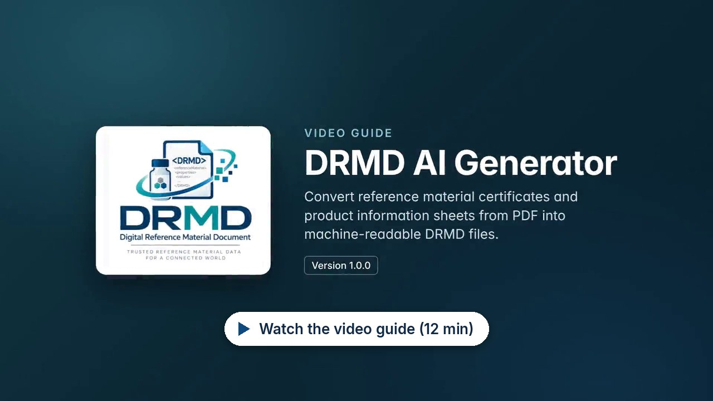

# DRMD AI Generator

Convert reference material certificates and product information sheets from PDF into machine-readable Digital Reference Material Documents (DRMD).

**Version 1.0.0** · Runs in the browser · No installation · **[Open the generator](https://punitharumilli.github.io/DRMD_Generator/)**

---

## Video guide

A 12-minute walkthrough of every step, from entering the API key to converting a whole folder, with spoken explanation and captions. Click the picture to watch it on the DRMD video site, with chapters, a transcript and a download option.

**Chapters.** Click a time to start the video at that point.

| Time | Chapter |
|---:|---|
| [0:00](https://punitharumilli.github.io/DRMD_Videos/?v=drmd-ai-generator) | Introduction |
| [0:20](https://punitharumilli.github.io/DRMD_Videos/?v=drmd-ai-generator&t=20) | Getting started |
| [0:52](https://punitharumilli.github.io/DRMD_Videos/?v=drmd-ai-generator&t=52) | Settings and API key |
| [1:27](https://punitharumilli.github.io/DRMD_Videos/?v=drmd-ai-generator&t=87) | Converting a certificate |
| [2:42](https://punitharumilli.github.io/DRMD_Videos/?v=drmd-ai-generator&t=162) | Administrative data |
| [5:04](https://punitharumilli.github.io/DRMD_Videos/?v=drmd-ai-generator&t=304) | Materials |
| [5:32](https://punitharumilli.github.io/DRMD_Videos/?v=drmd-ai-generator&t=332) | Properties |
| [7:36](https://punitharumilli.github.io/DRMD_Videos/?v=drmd-ai-generator&t=456) | Checking values |
| [8:24](https://punitharumilli.github.io/DRMD_Videos/?v=drmd-ai-generator&t=504) | Statements |
| [8:45](https://punitharumilli.github.io/DRMD_Videos/?v=drmd-ai-generator&t=525) | Comment and documents |
| [9:11](https://punitharumilli.github.io/DRMD_Videos/?v=drmd-ai-generator&t=551) | Validate and export |
| [10:39](https://punitharumilli.github.io/DRMD_Videos/?v=drmd-ai-generator&t=639) | Converting a folder |
| [12:02](https://punitharumilli.github.io/DRMD_Videos/?v=drmd-ai-generator&t=722) | Importing an XML file |
| [12:15](https://punitharumilli.github.io/DRMD_Videos/?v=drmd-ai-generator&t=735) | Summary |

---

## About

Reference material certificates and product information sheets are usually published as PDF documents. People can read them, but software cannot. The DRMD AI Generator reads these documents and converts them into DRMD XML files: a structured, machine-readable format based on the DRMD schema 1.0.0.

- **Extraction:** The content of the PDF is read automatically and placed into a structured form.
- **Review:** Every value can be located in the original PDF. Values that do not appear word for word in the document are marked for verification.
- **Data enrichment:** Units are converted to the D-SI format, and identifiers are added, such as CAS Registry Numbers and InChIKeys for substances and ROR IDs for organisations.
- **Validation:** Each document is checked against the DRMD schema and the official business rules before export.
- **Single documents or whole folders:** Each document is saved as a DRMD XML file together with a readable HTML report.
- **Built-in guidance:** Every field name in the generator links to the matching section of the DRMD Best Practice guide.

---

## Requirements

- Google Chrome 155 or Microsoft Edge 155, or a later version
- An internet connection
- An API key from one of the supported AI providers (see [AI providers](#ai-providers)). Usage is billed to the account the key belongs to.

Nothing needs to be installed, and no administrator rights are required.

---

## Getting started

1. Open the generator in Chrome or Edge, in one of two ways:
   - **Online:** go to <https://punitharumilli.github.io/DRMD_Generator/>
   - **As a file:** download **`DRMD-Generator.html`** from the [latest release](../../releases/latest) and open it, either by double-clicking it or by dragging it into a browser window.
2. Click **Settings**, choose an AI provider and enter your API key. **Check key** confirms that the key works.
3. Click **Upload PDF** to convert one document, or **Upload folder** to convert many.

When you convert a folder, the browser asks once for permission to save into it. Choose **Allow**. The XML file and HTML report of each document are saved next to its PDF.

---

## AI providers

The generator needs an AI model that can read PDF documents, both their text and their page images. You can use any of the providers below with your own API key. Not every provider is available in every country, so check the provider's list before you create a key.

| Provider | Models used with "Automatic" | API key | Countries |
|---|---|---|---|
| Google Gemini | gemini-3.8-flash, then gemini-3.6-flash, then gemini-3.5-flash-lite | [Google AI Studio](https://aistudio.google.com/apikey) | [Available regions](https://ai.google.dev/gemini-api/docs/available-regions) |
| OpenAI | gpt-6-luna, then gpt-6.1-sol | [OpenAI platform](https://platform.openai.com/api-keys) | [Supported countries](https://developers.openai.com/api/docs/supported-countries) |
| Anthropic | claude-haiku-5-5, then claude-sonnet-5-5 | [Anthropic API keys](https://platform.claude.com/settings/keys) | [Supported countries](https://www.anthropic.com/supported-countries) |
| Mistral AI | mistral-medium-latest, then mistral-small-latest | [Mistral console](https://console.mistral.ai/api-keys) | Check with Mistral AI |
| OpenRouter | google/gemini-3.8-flash, then anthropic/claude-haiku-5.5, then openai/gpt-6-luna | [OpenRouter](https://openrouter.ai/settings/keys) | Check with OpenRouter |

- **Automatic** is the recommended setting. The models listed are recent models that read PDF documents at a low price per token. They are tried in this order: when a model is busy, rate limited or not available to your key, the next one is used. OpenRouter does this itself, within one request, and one OpenRouter key gives access to models of many companies.
- **Check key** asks the provider whether the key works and lists every model of that key that can read the certificates. You can then choose one model instead of Automatic. Through OpenRouter, models that read images but not PDFs are marked: OpenRouter then converts the PDF to text first, for an extra fee.
- The instructions sent to the model are the same for every provider. Results can still differ between models, so review the extracted data in every case.

---

## Usage and costs

Under **Settings**, the generator shows the AI requests made in the open tab: per model, the number of requests, the input and output tokens, the cost and the average time per request.

- The token counts are the numbers each provider reports in its answers. Nothing is estimated.
- OpenRouter states the cost of each request in its answer; that amount is shown as it is. For Google, OpenAI, Anthropic and Mistral AI, the cost is the reported tokens multiplied by the provider's published list price, as checked on 23 October 2026. A model that is not in the generator's price list shows "price not listed".
- Not included: use within a free tier, discounts, taxes, Mistral AI's per-page fee for documents (where it applies), and requests that the generator stopped waiting for, which a provider may still bill. The provider's own billing page is the binding record.
- Google, OpenAI, Anthropic and Mistral AI publish no response times for these models; OpenAI and Anthropic only rate their models as faster or slower. OpenRouter shows the measured latency of each model on its website. The times in the generator are measured in your browser and depend on the size of the PDF and on how busy the provider is.
- The figures exist only in the open tab and are gone when it is closed or reloaded.

---

## Data and privacy

- The generator runs entirely in your browser, whether you open it online or as a file. There is no server, and your documents are not uploaded to GitHub or stored anywhere else.
- To extract the data, the PDF is sent to the AI provider you choose, using your own API key. Substance and organisation names are looked up at PubChem, CAS Common Chemistry and ROR.
- Your API keys are kept only while the page is open and are not saved.
- The generator itself collects nothing: no statistics, no cookies, no tracking.

How each provider treats what is sent to it, according to its own terms:

- **Google Gemini.** With a free-of-charge key, Google's [Gemini API terms](https://ai.google.dev/gemini-api/terms) allow Google to use the content sent and the answers to improve its products, and people at Google may read them. This does not apply to paid use, and in the European Economic Area, the United Kingdom and Switzerland the rules for paid use apply to free keys as well. For confidential documents, use a key from a Google Cloud project with billing enabled.
- **OpenAI** does not use data sent through its API to train its models. It keeps abuse-monitoring logs for up to 30 days.
- **Anthropic** does not use API inputs and outputs to train its models by default.
- **Mistral AI** may use API data to improve its services unless "Anonymous improvement data" is turned off in its console (Admin, Privacy).
- **OpenRouter** passes the request on to the company of the model. The generator asks OpenRouter to use only providers that do not collect the data.

Please make sure that your documents may be processed by the provider you choose before you use the generator.

> **Note:** Data extracted automatically must be reviewed before the documents are used or published.

---

## Security

The generator is built so that your API key stays with you:

- The key is held only in the open tab. It is not saved in the browser, in cookies or in any file, and it is gone when the tab is closed or reloaded.
- Each key is sent only to its own provider, in a request header and never in a web address. The other providers, PubChem, ROR and CAS never receive it, and parts of a key that a provider repeats in an error message are removed before the message is shown.
- A security policy built into the page lets only the generator's own code run, and lets the page connect only to the five AI providers (Google Gemini, OpenAI, Anthropic, Mistral AI and OpenRouter), PubChem, CAS Common Chemistry and ROR. Code hidden in a PDF, in an AI answer or in an imported XML file cannot run or send anything elsewhere.
- Anthropic accepts requests made directly from a web page only with an extra header that confirms this. The generator sends it, because the key is your own and is used only in your browser.
- Text from certificates, AI answers and imported files is always shown as text, and only ordinary web links are accepted.
- The generator does not run inside another website, or when another page could still reach its tab.

**Protect your key.** Anyone who has the key can use it at your expense:

- Restrict the key where the provider allows it, for example a Gemini key to the **Generative Language API** in Google AI Studio or Google Cloud.
- Set a budget alert or a spending limit with the provider.
- Use a personal key rather than one shared across an organisation, and do not share screenshots or recordings that show it.
- If a key may have been exposed, delete it at the provider and create a new one.

---

## Maintenance

Every three months, check for each provider that the recommended models are still offered, that the prices in the generator's price list match the provider's pricing page, and that the provider still accepts requests from a web page. Update the generator and the date in "Usage and costs" when something has changed.

---

## Documentation

**DRMD Best Practice guide:** <https://punitharumilli.github.io/BestPracticeDocs/>

The guide explains every element of the DRMD schema and its rules. You can also reach the relevant section directly by clicking any field name in the generator.

---

## License

<!-- LICENSE: add the licence text or a link to the LICENSE file here. -->

Code / Generator: EUPL-1.2 *(details to follow)*

The generator file includes open-source components, each under its own license: React, the Google Gen AI SDK, pdf.js, JSZip and the Inter typeface. Their notices are included in the file.
